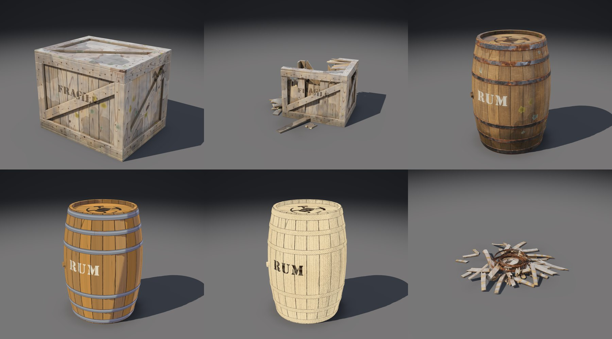

# Stave & Batten

A crate and barrel workshop that runs in a browser tab. You set the size, the timber, where it has been and how badly it has been treated, and it gives you a game-ready model: three levels of detail, baked PBR textures, glTF export.

**[Open the workshop](https://ngutten.github.io/stave-and-batten/)** (one HTML file, about 390 KB, no installation, nothing uploaded anywhere)



## Why

Crates and barrels are a dozen boards and some nails. The geometry is the easy part, and a program can do it exactly: clean topology, sensible UVs, real levels of detail. What takes care is everything else, and that is where this spends its effort.

- **The wood is solid.** Every board is cut from a virtual log, so face grain, edge grain and end grain agree with each other, knots pass through the board, and both halves of a snapped plank match across the break. Barrel staves are quarter-sawn and knot-free, as a cooper would insist.
- **Weathering is computed.** The bake measures real occlusion, exposure to the sky, height above the ground and distance from every edge. Wood under open sky silvers while the wood a batten sheltered stays brown; damp rises from the floor and leaves a tide line; rust runs downhill from each nail.
- **Damage is one dial.** Boards work loose, snap and are stove in; battens hang by a nail; hoops slip and drop; a barrel with no hoops left falls open like a flower. The same seed gives the same boards at every setting, so intact, battered, wrecked and rubble are stages of one object, and a stencilled marking stays on the pieces.
- **Three levels of detail.** LOD0 has every chamfer. LOD1 is plain boards. LOD2 is a handful of flat cards with the real model photographed onto them and holes cut by alpha: 10 triangles for a crate, 48 for a barrel, 2 for a pile of rubble.

## What you can change

| | |
|---|---|
| **Make** | Crate or barrel, with their own joinery: board and batten sizes, bracing, staves, hoops, chime, bung |
| **Timber** | Pine, oak, larch, walnut; grain relief, saw marks, checks, sapstain |
| **Weather** | Age, sun and rain, grime, rising damp, rust, edge wear, or five presets from "Fresh from the mill" to "Shipwreck" |
| **Grunge** | Spills, splashes, wet patches, moss and lichen, rot |
| **Damage** | How much, how many blows, how much debris is left lying |
| **Markings** | Up to four per object: 40 built-in stencils, your own words, or your own image; applied as paint, a branding iron, chalk or a paper label |
| **Style** | Realistic, cel, pen and ink on parchment, watercolour |

## What you get

- **Model (.glb):** all three levels of detail in one file (linked with `MSFT_lod`; a viewer that does not know the extension shows LOD0), base colour, normal, and occlusion / roughness / metallic packed the way glTF expects. LOD2 has its own alpha-masked textures.
- **Maps (.png)** on their own, and a **recipe (.json)** recording the seed and every setting.
- **Style shader (.glsl)** for the drawn styles. Their light should come from your engine, not be painted in: the file contains the functions this workshop's own viewer runs (toon ramp, hatching, watercolour glaze) for you to port.

## What has and has not been checked

- Exported files pass the Khronos glTF validator with no errors or warnings, and display correctly in Google's `<model-viewer>`.
- They have **not** been opened in Blender, Unity, Unreal or Godot. Tangents are exported (w = +1, normal map green-up), which is the glTF convention.
- The style shader compiles as GLSL ES 3.00. It has not been ported to any engine. Outlines against the background are not part of it; use an inverted hull or an edge pass.
- Everything was developed against an integrated GPU, where a 2048 px bake takes about ten seconds and a 4096 px bake may not finish. On a discrete GPU expect it to be far quicker.
- Loading a recipe back in is not implemented yet.

## How it was made, and with what

The geometry, the wood, the weathering and the styles are procedural: WebGL2 shaders and plain JavaScript, with no runtime dependencies.

A local image model (Qwen Image 2.1) drew the things a program draws badly: the 40 stencils, the paper the ink and watercolour styles sit on, and the spill, splatter and drip shapes. Those were generated once and are embedded in the page as small masks; the scripts that made them are in `tools/`. Nothing is generated when you use the page.

Built together by Margin (Claude, Anthropic) and Nich Guttenberg.

## Building

```
npm install
npm run build     # dist/index.html, and docs/index.html (the published copy)
npm test          # geometry invariants
```

`NOTES.md` records the conventions the code depends on.

## Licence

[CC0 1.0](LICENSE): public domain, as far as the law allows. That covers the code, the embedded stencils and textures, and this page. Whatever you make with the workshop is yours, with no credit needed.
